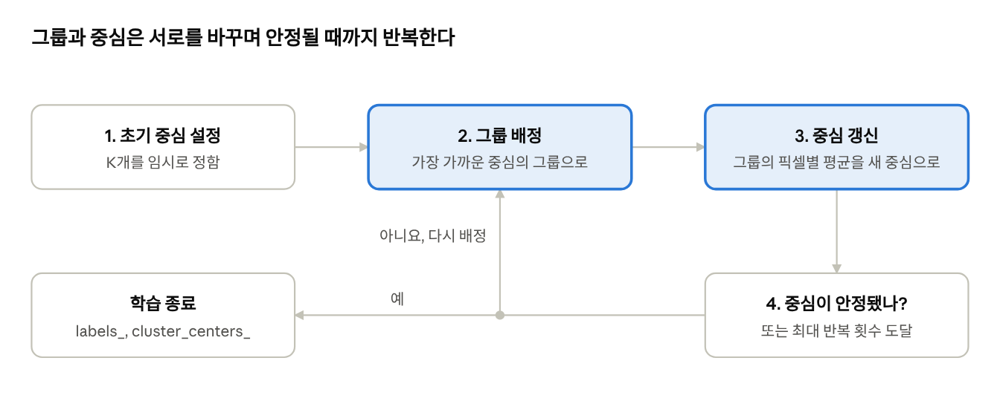
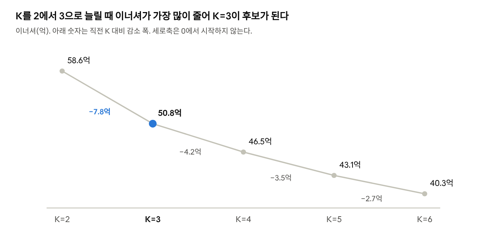

# Day 3 · 이론 1. 비지도 학습과 K-평균

Nov 2, 2026 · @Lee Hyunwoo

K-평균은 정답 없이 과일 사진 300장을 3개 그룹으로 나눴고, 클러스터별 다수 과일 기준으로 288장(96%)이 맞았다. 96%는 정답을 아는 이번 실습에서만 사후에 계산할 수 있는 값이다.

이 문서는 『혼자 공부하는 머신러닝+딥러닝』 06-1 군집 알고리즘과 06-2 k-평균을 정리한다. 공식 실습은 `6-1.ipynb`, `6-2.ipynb`다. 수치는 로컬 `fruits_300.npy`와 scikit-learn 1.9.1로 직접 실행한 값이고, 교안의 출력과 일치했다.

## 비지도 학습과 군집

분류와 군집의 핵심 차이는 학습할 때 정답 레이블을 주는지다. 군집은 비지도 학습의 한 종류로, 비슷한 샘플을 모아 **클러스터**를 만든다.

| 구분 | 지도 학습의 분류 | 비지도 학습의 군집 |
| --- | --- | --- |
| 학습 코드 | `lr.fit(X, y)` | `km.fit(X)` |
| 학습 데이터 | 입력과 정답 | 입력만 |
| 핵심 질문 | 이 샘플은 어떤 클래스인가? | 어떤 샘플끼리 비슷한가? |
| 결과의 의미 | 학습한 클래스에 대한 예측 | 유사성으로 만든 그룹 |

훈련 데이터가 없는 것이 아니라 **정답이 없는** 것이다. 교안의 "테스트 데이터에서는 여전히 정답이 필요하다"는 평가 방식에 따라 달라진다.

- 분류 모델의 정확도를 재려면 정답이 필요하다.
- `predict()` 자체에는 정답이 필요 없다.
- 군집은 이너셔처럼 정답 없이 보는 지표를 쓰거나 클러스터 내용을 직접 확인한다.

## 이미지를 숫자로 다루기

사진 한 장은 100 × 100 픽셀의 숫자 배열이고, 이를 한 줄로 펼치면 특성 10,000개가 된다. `reshape`는 모양만 바꾸고 픽셀값은 바꾸지 않는다.

| 배열 | 크기 | 뜻 |
| --- | --- | --- |
| `fruits` | (300, 100, 100) | 사진 300장, 높이 100, 너비 100 |
| `fruits_2d` | (300, 10000) | 샘플 300개, 특성 10,000개 |

`imshow`의 `cmap='gray_r'`은 화면 색만 바꾼다. 배열의 픽셀값은 그대로다.

### 사진별 평균과 픽셀별 평균

사진별 평균으로는 사과와 파인애플을 구별하기 어렵다. 사진별 평균의 평균이 사과 93.0, 파인애플 96.3으로 비슷하고, 바나나만 34.6으로 낮다. 사진을 숫자 하나로 줄이면 위치 정보가 사라지기 때문이다.

| 구분 | 사진별 평균 | 픽셀별 평균 |
| --- | --- | --- |
| 코드 | `apple.mean(axis=1)` | `apple.mean(axis=0)` |
| 계산 | 사진 한 장의 픽셀 전체를 평균 | 사진 100장의 같은 위치 픽셀끼리 평균 |
| 결과 크기 | (100,) | (10000,) |
| 남는 정보 | 사진의 전체적인 밝기 | 과일의 위치별 패턴 |

픽셀별 평균을 `(100, 100)`으로 되돌리면 과일의 **대표 이미지**가 된다. 사과 대표 이미지와 픽셀 차이의 절댓값 평균이 작은 사진 100장을 고르면 100장 모두 사과였다.

다만 이 방법은 정답 정보를 두 가지 썼다. 어떤 사진이 사과인지, 사과가 몇 장인지를 알고 있었다. 이 두 가지 없이 그룹을 찾는 것이 K-평균이다.

## K-평균 알고리즘

K-평균은 가까운 중심에 배정하고 그룹 평균으로 중심을 갱신하는 과정을 반복해, 정답 없이 그룹과 대표 이미지를 함께 찾는다. 각 그룹의 특성별 평균이 클러스터 중심(센트로이드)이다.



*K-평균의 작동 순서 · 교안 6-2*

그룹이 바뀌면 중심이 바뀌고, 중심이 바뀌면 배정이 바뀔 수 있어서 한 번으로 끝나지 않는다. 이번 실행의 반복 횟수(`n_iter_`)는 4번이다.

가까움은 유클리드 거리로 잰다. 픽셀값 차이를 제곱해 모두 더한 뒤 제곱근을 구한다.

```latex
d(x, c) = \sqrt{\sum_{i=1}^{10000} (x_i - c_i)^2}
```

앞에서 대표 이미지와 비교할 때는 절댓값 평균을 썼다. 둘 다 가까움을 재지만 같은 계산은 아니다.

교안은 초기 중심을 무작위로 정한다고 설명한다. scikit-learn의 기본값은 `init='k-means++'`, `n_init='auto'`로, 초기 중심을 서로 멀리 떨어지도록 확률적으로 고른다.

## 과일 사진 실습 결과

`KMeans(n_clusters=3, random_state=42)`는 사진 300장을 112 / 98 / 90장으로 나눴다. 파인애플은 한 그룹에 모두 모였고, 사과 10장과 바나나 2장이 그 그룹에 섞였다.

| 클러스터 | 샘플 수 | 파인애플 | 사과 | 바나나 |
| --- | --- | --- | --- | --- |
| 0 | 112 | 100 | 10 | 2 |
| 1 | 98 | 0 | 0 | 98 |
| 2 | 90 | 0 | 90 | 0 |

K-평균은 과일 종류가 아니라 픽셀값이 비슷한 사진을 묶는다. 그래서 다른 과일이 섞일 수 있다. "0번은 주로 파인애플"이라는 해석은 사람이 사진을 보고 내린다.

### 학습 결과를 확인하는 기능

| 기능 | 확인하는 내용 | 이번 실행 |
| --- | --- | --- |
| `labels_` | 학습 데이터의 소속 클러스터 | 크기 112 / 98 / 90 |
| `cluster_centers_` | 클러스터별 픽셀 평균 | 중심 3개, 각 10,000개 값 |
| `transform()` | 각 중심까지의 거리 | 인덱스 100 사진: 3400.2 / 8837.4 / 5279.3 |
| `predict()` | 가장 가까운 중심의 번호 | 같은 사진: [0] |
| `n_iter_` | 배정과 갱신을 반복한 횟수 | 4 |

사진 300장 모두 `labels_`가 `transform()`의 최소 거리 위치와 일치했다. `fruits_2d[100:101]`처럼 슬라이스로 선택하면 사진 한 장도 `(1, 10000)` 형태를 유지한다.

### 초기값에 따라 결과가 달라진다

`n_init=1`로 시드만 바꾸자, 시드 0에서는 한 클러스터에 201장이 몰렸다. K-평균은 좋지 않은 결과에 머물 수 있어서 `n_init`을 늘려 여러 번 시작하기도 한다.

| 시드 | 클러스터 크기 | 이너셔 | 인덱스 100 사진의 번호 |
| --- | --- | --- | --- |
| 0 | 47 / 52 / 201 | 54.98억 | 0 |
| 1 | 91 / 98 / 111 | 50.75억 | 0 |
| 2 | 48 / 98 / 154 | 54.92억 | 2 |
| 3 | 91 / 98 / 111 | 50.75억 | 0 |
| 4 | 91 / 98 / 111 | 50.75억 | 1 |
| 5 | 91 / 98 / 111 | 50.75억 | 2 |

시드 1, 3, 4, 5는 크기와 이너셔가 같은데, 시드 1·4·5에서 같은 사진의 번호가 0, 1, 2로 다르다. **클러스터 번호는 이름표일 뿐 과일 종류가 아니다.**

## K 정하기: 이너셔와 엘보우

이너셔가 가장 작은 K가 아니라, K를 늘렸을 때 감소 폭이 둔해지는 지점을 후보로 고른다. 이너셔는 각 샘플과 소속 중심 사이 거리의 제곱합이다.

```latex
\text{inertia} = \sum_{i=1}^{n} \lVert x_i - c_{\text{label}(i)} \rVert^2
```

이 정의는 실행으로도 확인했다. `transform()`의 최소 거리를 제곱해 더한 값이 `inertia_`와 같았다.



*로컬 실행 · fruits_300.npy, KMeans(n_init='auto', random_state=42), K=2~6*

K=3 이후 감소 폭이 절반 수준으로 줄어 K=3이 후보가 된다. 다만 그래프가 뚜렷하게 꺾이지는 않아서, 후보를 찾은 뒤 실제 클러스터에 어떤 사진이 모였는지 함께 확인해야 한다.

K를 계속 늘리면 이너셔는 대체로 줄고, 사진 300장을 각각 클러스터로 만들면 0이 된다. 이때는 비슷한 사진끼리 묶는다는 군집의 목적이 사라진다.

## 헷갈리기 쉬운 내용과 핵심 질문

가장 자주 헷갈리는 것은 훈련 데이터와 정답의 구분이다. K-평균에도 훈련 데이터는 있고, 없는 것은 정답 레이블이다.

| 헷갈리기 쉬운 이해 | 정확한 내용 |
| --- | --- |
| train data 없이 fit한다 | 훈련 데이터는 있고, 정답 없이 fit한다 |
| 이미지 한 장이 300건이다 | 사진 300장, 한 장당 특성 10,000개다 |
| 클러스터 번호는 과일 종류다 | 그룹을 구분하는 이름표이고 시드에 따라 바뀐다 |
| 중심이 클러스터에 배정된다 | 배정되는 것은 사진이고, 중심은 그 기준이다 |
| 엘보우 지점이 곧 정답인 K다 | 후보를 찾는 도구이고, 클러스터 내용도 확인한다 |
| K-평균과 KNN은 비슷하다 | K-평균의 K는 클러스터 수(비지도), KNN의 k는 이웃 수(지도)다 |

K-평균은 거리 기반이라 KNN처럼 특성 스케일의 영향을 받는다. 이번 실습은 모든 특성이 같은 범위의 픽셀이라 표준화하지 않았다.

### 핵심 질문 답안

1. **분류와 군집의 차이는?** 분류는 정답 레이블로 학습해 클래스를 예측한다. 군집은 레이블 없이 유사성으로 그룹을 만든다.
2. **사진별 평균과 픽셀별 평균의 차이는?** 사진별 평균은 위치 정보를 잃는다. 픽셀별 평균은 위치별 패턴이 남아 형태 차이를 볼 수 있다.
3. **정답 없이 그룹을 어떻게 찾나?** 초기 중심을 정한 뒤 배정과 갱신을 반복한다. 중심과 그룹이 서로를 바꾸므로 안정될 때까지 반복한다.
4. **번호 0·1·2의 의미는?** 그룹 이름표다. 픽셀 유사성이 종류와 항상 일치하지 않아, 클러스터 0에 사과 10장과 바나나 2장이 섞였다.
5. **가장 큰 K를 고르면 되나?** 아니다. K=300이면 이너셔는 0이지만 군집의 의미가 없다. 감소 폭이 둔해지는 지점을 후보로 보되, 뚜렷하지 않을 수 있다.

### 다음 학습

사진 한 장은 픽셀 특성 10,000개로도, `transform()`의 거리 3개로도 표현할 수 있다. 다음 시간에는 중요한 정보를 최대한 유지하면서 특성 수를 줄이는 방법(PCA)을 배운다.
