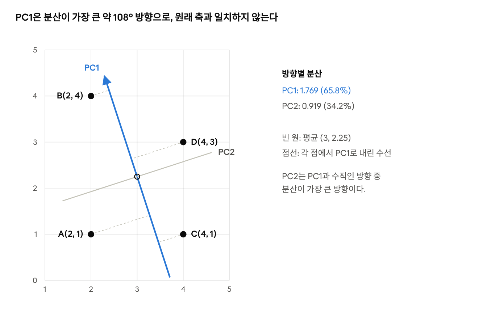
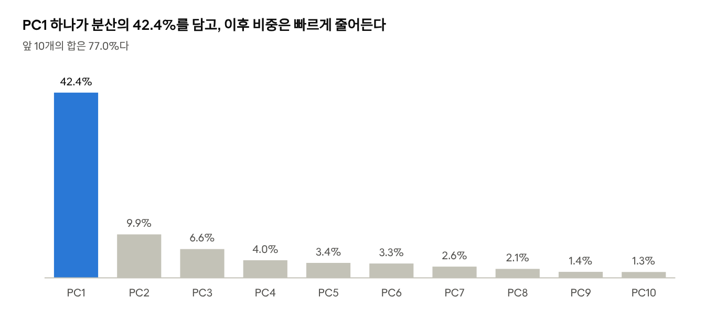

# Day 3 · 이론 2. 주성분 분석

Nov 2, 2026 · @Lee Hyunwoo

PCA는 과일 사진 300장의 특성을 10,000개에서 50개로 줄이고도 전체 분산의 92.1%를 남겼고, 로지스틱 회귀 정확도는 99.67%로 그대로였다. 2개로 줄여도 98.67%였지만, 1개에서는 77.33%로 떨어졌다.

이 문서는 『혼자 공부하는 머신러닝+딥러닝』 06-3 주성분 분석을 정리한다. 수치는 로컬 `fruits_300.npy`와 scikit-learn 1.9.1로 직접 실행한 값이다. 교안의 출력과 일치했고, 학습 시간만 실행 환경에 따라 달랐다. 위 정확도는 데이터 누수가 없는 파이프라인 교차 검증 값이다.

## 투영과 분산

PCA는 점이 겹치지 않는 방향이 아니라 분산이 가장 큰 방향을 고른다. 투영은 데이터를 특정 축 위의 위치로 옮겨 표현하는 것이고, 그 축과 수직인 방향의 차이는 사라진다.

교안의 네 점은 수치로 역산하면 A(2, 1), B(2, 4), C(4, 1), D(4, 3)이다. 이 좌표는 교안의 평균 (3, 2.25)와 방향별 분산을 모두 재현한다.



*교안 수치로 역산한 네 점 · 로컬 실행 scikit-learn 1.9.1*

| 투영 방향 | A | B | C | D | 겹치는 점 | 분산 |
| --- | --- | --- | --- | --- | --- | --- |
| 가로 (0°) | 2 | 2 | 4 | 4 | A=B, C=D | 1.000 |
| 45° | 2.12 | 4.24 | 3.54 | 4.95 | 없음 | 1.094 |
| 135° | -0.71 | 1.41 | -2.12 | -0.71 | A=D | 1.594 |
| 세로 (90°) | 1 | 4 | 1 | 3 | A=C | 1.688 |
| PC1 (약 108°) | -0.88 | 1.97 | -1.50 | 0.40 | 없음 | 1.769 |

- **겹침과 분산은 다르다.** 45°는 겹침이 없지만 분산이 작고, 세로축은 A와 C가 겹치는데도 분산이 더 크다.
- **대각선이라고 분산이 작은 것은 아니다.** 이 데이터는 공분산이 음수라 135°가 45°보다 분산이 크다.
- **PC1은 새 축이다.** PC1 = -0.309 × 가로 + 0.951 × 세로로, 원래 특성을 섞어 만든다.

분산을 남기는 이유는 데이터의 변동을 최대한 보존하기 위해서다. 다만 PCA가 보존하는 정보와 분류에 필요한 정보는 다르다. 조명 차이처럼 종류와 무관한 변동도 분산이 크면 앞쪽 주성분이 될 수 있다.

## PCA의 계산 원리

PCA는 공분산 행렬의 고유벡터를 축으로 삼고, 고유값이 큰 순서로 남긴다. 고유벡터는 방향이고, 고유값은 그 방향의 분산 크기다.

1. **평균 빼기.** 데이터 중심을 원점으로 옮긴다. 네 점의 쌍별 거리 6개는 전후로 모두 같았다.
2. **공분산 구하기.** 두 특성이 함께 변하는 방향을 잰다. 네 점의 편차 곱은 1.25, -1.75, -1.25, 0.75이고 평균은 -0.25다.
3. **축 찾기.** 공분산 행렬을 고유값 분해한다. PC1은 분산이 가장 큰 방향이고, PC2는 PC1과 수직인 방향 중 분산이 가장 큰 방향이다.
4. **투영하기.** 각 샘플을 축에 투영한 좌표를 새 특성으로 쓴다. 앞쪽 주성분만 고를 때 비로소 차원이 줄어든다.

```latex
C=\begin{bmatrix}1 & -0.25\\ -0.25 & 1.6875\end{bmatrix},\qquad Cv=\lambda v
```

행렬을 풀면 λ₁ = 1.7688, λ₂ = 0.9187이고 v₁ = (-0.309, 0.951)이다. Cv₁과 λ₁v₁은 모두 (-0.547, 1.682)로 같고, v₁에 투영한 분산도 1.7688이다. 두 고유값의 합 2.6875는 원래 분산의 합과 같아서, 축을 돌려도 전체 분산은 보존된다.

설명된 분산 비율은 고유값을 전체 고유값의 합으로 나눈 값이다. 네 점은 PC1이 65.8%, PC2가 34.2%다. 주성분 2개를 다 쓰면 쌍별 거리가 모두 그대로여서, 축만 돌아간 셈이다.

### 분산 최대와 복원 오차 최소는 같은 문제다

축 하나로 투영한 뒤 복원하면 남긴 분산과 복원 오차의 합이 항상 전체 분산이다. 그래서 분산을 많이 남길수록 오차가 작아진다.

| 축 | 남긴 분산 | 샘플당 복원 오차 | 합 |
| --- | --- | --- | --- |
| 가로 | 1.000 | 1.688 | 2.688 |
| 45° | 1.094 | 1.594 | 2.688 |
| 135° | 1.594 | 1.094 | 2.688 |
| 세로 | 1.688 | 1.000 | 2.688 |
| PC1 | 1.769 | 0.919 | 2.688 |

0.1° 간격으로 모든 방향을 시험해도 최소 오차는 0.9187이었고, 이는 버린 고유값과 같다. 이 방향이 어떤 축보다 오차가 작다는 수학적 근거는 Eckart–Young 정리다.

수학적 원리는 수학 특강에서 다룬다. 찾아볼 키워드는 고유값 분해와 특이값 분해(SVD)다. 사이킷런의 `PCA`는 보통 SVD로 계산하지만 얻는 주성분과 분산은 같다.

## 과일 사진 실습

주성분 50개는 전체 분산의 92.1%를 남긴다. 공식 실습은 `6-3.ipynb`다.

```python
pca = PCA(n_components=50, random_state=42)
pca.fit(fruits_2d)
fruits_pca = pca.transform(fruits_2d)
fruits_inverse = pca.inverse_transform(fruits_pca)
```

| 배열 | 크기 | 뜻 |
| --- | --- | --- |
| `fruits_2d` | (300, 10000) | 원본 사진 300장 |
| `pca.components_` | (50, 10000) | 주성분 50개, 각 축은 픽셀 10,000개의 가중치 |
| `fruits_pca` | (300, 50) | 각 사진의 주성분 좌표 |
| `fruits_inverse` | (300, 10000) | 크기만 복원한 근사 사진 |



*로컬 실행 · fruits_300.npy, PCA(n_components=50, random_state=42), 앞 10개*

그 뒤로도 비중은 계속 줄어 PC20은 0.48%, PC30은 0.30%, PC50은 0.16%다.

보존 분산 90%, 95%, 99%에는 주성분이 각각 39개, 74개, 162개 필요하다. `n_components`는 정수면 주성분 개수이고, 0~1 사이 실수면 보존할 분산 비율이다. `n_components=0.5`는 2개를 골랐다.

### 복원

복원해도 버린 정보는 돌아오지 않는다. 주성분이 늘수록 오차는 줄고, 오차는 버린 고유값의 합과 거의 같다.

| 주성분 수 | 보존 분산 | 픽셀당 복원 MSE |
| --- | --- | --- |
| 2 | 52.3% | 1551.8 |
| 10 | 77.0% | 749.9 |
| 50 | 92.1% | 255.7 |
| 150 | 98.7% | 41.0 |

사진 한 장의 값은 10,000개에서 50개로 200분의 1이 되지만, 복원까지 하려면 축과 평균도 저장해야 한다. 전체 값은 300만 개에서 52.5만 개(300 × 50 + 50 × 10,000 + 10,000)로, 약 5.7분의 1이다.

### 앞쪽 주성분의 의미와 계산법

PC1은 사실상 밝기 축이다. PC1 좌표와 사진 평균 밝기의 상관은 0.993이고, 같은 과일 안에서도 0.92~0.96이다.

이 데이터에서 사이킷런은 주성분 50개에 근사 계산법(`randomized`)을 고른다. 시드 0과 1에서 PC1, PC2, PC10의 방향은 일치했지만 PC50은 코사인 유사도가 0.18이었다. 뒤쪽 주성분 하나하나의 방향에 큰 의미를 두면 안 된다. `svd_solver='full'`로 반복하면 결과가 완전히 같았다.

## 분류 모델과 결합

특성을 2개까지 줄여도 정확도는 거의 유지되지만, 1개에서는 사과와 파인애플이 섞인다. `LogisticRegression(max_iter=1000)`과 5-폴드 교차 검증의 결과다. 시간은 폴드별 학습 시간의 평균이고 실행 환경에 따라 달라진다.

| 입력 | 전체 데이터로 PCA 후 CV | 분류기 시간 | 파이프라인 CV | PCA 포함 시간 |
| --- | --- | --- | --- | --- |
| 원본 10,000개 | 99.67% | 0.175초 | - | - |
| 주성분 50개 | 99.67% | 0.007초 | 99.67% | 0.107초 |
| 주성분 2개 | 99.33% | 0.016초 | 98.67% | 0.086초 |
| 주성분 1개 | 76.00% | 0.014초 | 77.33% | 0.058초 |

- **전체 데이터로 PCA를 학습하면 검증 폴드 정보가 섞인다.** 파이프라인으로 폴드마다 훈련 데이터로만 PCA를 학습해야 한다.
- **시간 이득은 PCA를 포함하면 크게 줄어든다.** 주성분 50개는 약 25배에서 약 1.6배가 된다. 분류기를 여러 번 학습하거나 특성이 훨씬 많으면 달라질 수 있다.
- **특성이 적다고 항상 빠르지는 않다.** 기본 설정으로 전체 데이터를 학습하면 반복 횟수는 주성분 50개가 23번, 2개가 한도인 100번, 1개가 77번이었다.

교안의 2개 정확도 99.3%는 기본 `LogisticRegression()`의 값이다. 반복 한도와 계산법에 따라 99.33%와 99.67%를 오가는데, 차이는 검증 폴드 하나의 사진 1장이라 의미를 두지 않는다.

### 주성분 1개에서 무너지는 이유

분산이 큰 PC1만으로는 사과와 파인애플을 구별하지 못한다. 주성분 1개 파이프라인의 예측 결과다.

| 실제 \ 예측 | 사과 | 파인애플 | 바나나 |
| --- | --- | --- | --- |
| 사과 | 65 | 35 | 0 |
| 파인애플 | 32 | 68 | 0 |
| 바나나 | 0 | 1 | 99 |

PC1 평균은 사과 2721, 파인애플 2358, 바나나 -5079다. 바나나는 밝기로 갈리지만, 사과와 파인애플은 표준편차가 522와 405여서 분포가 크게 겹친다.

| 주성분 | 분산 비율 | 과일 종류로 설명되는 비중 |
| --- | --- | --- |
| PC1 | 42.4% | 93.8% |
| PC2 | 9.9% | 74.1% |
| PC3 | 6.6% | 0.8% |
| PC4 | 4.0% | 0.2% |
| PC5 | 3.4% | 1.0% |

PC2가 빠지면 정확도가 21%p 떨어진다. PC3~PC5는 분산이 적지 않은데도 종류와 거의 무관하다. 그래서 주성분 수는 분산 비율만으로 정하지 않고 목적 지표로도 확인해야 한다.

## K-평균과 결합

주성분 2개로 돌린 K-평균은 300장을 110 / 99 / 91장으로 나눴고, 클러스터별 다수 과일과 290장이 일치했다. 원본 10,000개로 돌린 288장보다 2장 많지만, 시드 하나의 결과라 PCA가 군집을 개선한다는 근거는 아니다.

| 클러스터 | 샘플 수 | 파인애플 | 사과 | 바나나 |
| --- | --- | --- | --- | --- |
| 0 | 110 | 100 | 9 | 1 |
| 1 | 99 | 0 | 0 | 99 |
| 2 | 91 | 0 | 91 | 0 |

주성분 2개는 좌표가 2개여서 산점도로 바로 그릴 수도 있다. 다만 산점도에 보이는 것은 전체 분산의 52.3%이다.

## 헷갈리기 쉬운 내용과 핵심 질문

가장 자주 헷갈리는 것은 분산 92%와 정확도의 관계다. 설명된 분산은 정확도가 아니라 입력의 변동을 남긴 비율이다.

| 헷갈리기 쉬운 이해 | 정확한 내용 |
| --- | --- |
| PCA는 중요한 특성을 고른다 | 원래 특성을 섞어 새 축을 만든다 |
| 중요한 주성분은 분류에 중요하다 | 중요하다는 것은 분산이 크다는 뜻이다 |
| 축을 바꾸면 차원이 줄어든다 | 좌표 일부를 버릴 때 줄어든다 |
| 고유값만 남긴다 | 고유값이 큰 고유벡터를 남긴다 |
| 복원하면 원본이 된다 | 크기만 돌아오고 버린 정보는 돌아오지 않는다 |
| PCA는 단위와 무관하다 | 분산이 기준이라 단위가 다르면 보통 먼저 표준화한다 |
| K-평균과 PCA의 `transform()`은 같다 | K-평균은 중심까지의 거리, PCA는 축 위의 좌표다 |

강사님은 자연어 처리에서 텍스트 단위와 임베딩을 다룬 경험을 들어, 처음에는 차원 축소를 잘하면 결과가 좋아질 줄 알았다고 했다. 결론은 버린 정보는 복원할 수 없으므로, 감당할 수 있는 손실 수준을 정하는 것이 핵심이라는 것이다.

### 핵심 질문 답안

1. **왜 비지도 학습인가?** `pca.fit(X)`처럼 정답 없이 입력의 분포만 쓴다.
2. **왜 분산이 큰 방향인가?** 변동을 최대한 남기기 위해서다. 같은 차원으로 줄일 때 복원 오차도 최소가 된다.
3. **축을 바꾸면 차원이 줄어드는가?** 아니다. 좌표 일부를 버릴 때 줄어든다.
4. **설명된 분산 92%면 정확도도 92%인가?** 아니다. 분산 52.3%만 남긴 주성분 2개의 정확도가 98.67%였다.
5. **복원하면 원본과 같아지는가?** 일반적으로 다르다. 크기만 (300, 10000)으로 돌아온다.

### 다음 학습

K-평균은 비슷한 샘플을 묶고, PCA는 특성을 합친다. 다음 이론의 내용은 교안이 나오면 이어서 정리한다.
