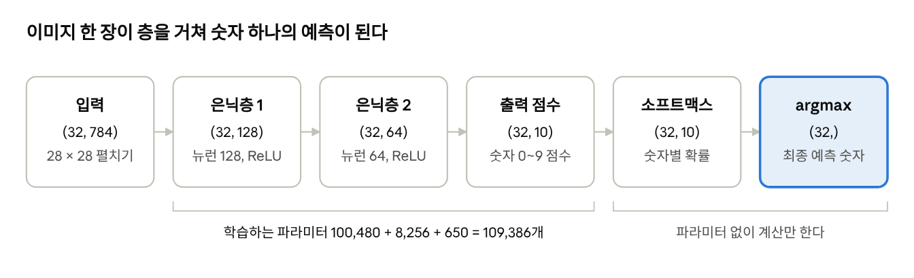

# Day 3 · 이론 3. 퍼셉트론에서 다층 신경망까지

Nov 2, 2026 · @Lee Hyunwoo

다층 신경망은 "가중합 → 편향 더하기 → 활성화 함수"를 층마다 반복해 예측값을 만든다. 비선형 활성화 함수가 없으면 층을 아무리 쌓아도 하나의 선형 계산으로 합쳐져 XOR조차 풀지 못한다.

이 문서는 이론 3의 강의 메모를 정리하고, NumPy와 PyTorch 2.14.1로 직접 실행해 확인한 것이다. 교안 전문은 받지 못했다. 예시의 가중치와 은닉층 크기 128, 64는 설명을 위해 정한 값이고 교안의 값이 아니다.

## 퍼셉트론과 XOR

퍼셉트론 하나는 XOR를 풀지 못하지만, 여러 개를 연결하면 풀 수 있다. 퍼셉트론은 가중합이 0보다 크면 1, 그렇지 않으면 0을 출력한다.

| 방법 | (0,0) | (0,1) | (1,0) | (1,1) | 결과 |
| --- | --- | --- | --- | --- | --- |
| 정답 | 0 | 1 | 1 | 0 | |
| 최적의 선형 모델 | 0.5 | 0.5 | 0.5 | 0.5 | 실패 (MSE 0.25) |
| 계단 함수 2층 (NAND, OR → AND) | 0 | 1 | 1 | 0 | 성공 |
| ReLU 2층: h(x₁+x₂) - 2h(x₁+x₂-1) | 0 | 1 | 1 | 0 | 성공 |

선형 모델은 네 점 모두에 0.5라고 답하는 것이 최선이다. 여러 퍼셉트론으로 XOR를 풀 수 있었던 것은 각 퍼셉트론에 계단 함수라는 비선형 변환이 있었기 때문이다. 비선형이기만 하면 계단 함수가 아니어도 된다.

### 층만 쌓으면 합쳐진다

활성화 함수 없이 가중치와 편향만 계산하는 층을 연결하면 결과는 하나의 선형 계산이다.

```latex
W_2(W_1x+b_1)+b_2=(W_2W_1)x+(W_2b_1+b_2)
```

임의의 가중치로 2개 층을 계산한 결과와, 합친 W와 b 하나로 계산한 결과가 일치했다. 층을 몇 개 쌓아도 마찬가지다.

## 활성화 함수

활성화 함수는 가중합을 비선형으로 변환해 다음 층에 넘긴다. 지금은 수식 계산보다, 입력을 어떻게 바꾸고 왜 비선형이 필요한지 이해하는 것이 중요하다.

```latex
a = \sum_i w_i x_i + b,\qquad \text{출력} = h(a)
```

| 함수 | 식 | 출력 범위 | a = -2 | a = 0 | a = 2 |
| --- | --- | --- | --- | --- | --- |
| 계단 | a > 0이면 1, 아니면 0 | 0 또는 1 | 0 | 0 | 1 |
| 시그모이드 | 1 / (1 + exp(-a)) | 0과 1 사이 | 0.119 | 0.5 | 0.881 |
| ReLU | max(0, a) | 0 이상 | 0 | 0 | 2 |

시그모이드는 Day 2 로지스틱 회귀에서 z 점수를 확률로 바꾼 함수와 같다. 강의의 a가 그때의 z다.

### 은닉층의 시그모이드 출력은 확률이 아니다

0과 1 사이의 값일 뿐, 무엇이 일어날 확률인지 정해져 있지 않다. a가 2, 1.5, 3인 은닉 뉴런 세 개의 출력은 0.881, 0.818, 0.953으로 합이 2.651이다. 다음 층이 받는 중간 특성값으로 보면 된다.

### 계단 함수 대신 시그모이드와 ReLU를 쓰는 이유

- **계단 함수**: 거의 모든 구간의 기울기가 0이라 경사 하강법으로 가중치를 고칠 수 없다.
- **시그모이드**: 기울기가 최대 0.25이고 a = 5에서는 0.0066이다. 역전파는 기울기를 층마다 곱하므로, 최대치로 잡아도 10층이면 약 9.5 × 10⁻⁷이다. 이것이 기울기 소실이다.
- **ReLU**: 양수 구간의 기울기가 1이라 이 문제가 덜하다. 대신 입력이 계속 음수인 뉴런은 기울기가 0이 되어 학습이 멈출 수 있다.

강사님은 층을 거치며 원래 특징값이 잠재 변수로만 남고, 문장이 길어지면 퇴색되는 문제가 Transformer의 배경이라고 덧붙였다. 메모가 끊겨 있어 세부 내용은 확인하지 못했고, 이후 수업에서 다시 다룬다고 했다.

## 순전파와 행렬 계산

순전파는 입력에서 시작해 각 층을 차례로 계산하여 최종 출력을 구하는 과정이다. 앞 층의 출력이 다음 층의 입력이 된다.

입력 (1, 2)를 뉴런 3개에 넣는 예시다. 각 뉴런은 같은 입력을 받지만 가중치와 편향이 달라 결과가 다르다.

| 뉴런 | 가중합 + 편향 | a | 시그모이드 출력 |
| --- | --- | --- | --- |
| 1 | 1×0.1 + 2×0.2 + 0.1 | 0.6 | 0.6457 |
| 2 | 1×0.3 + 2×0.4 + 0.2 | 1.3 | 0.7858 |
| 3 | 1×0.5 + 2×0.6 + 0.3 | 2.0 | 0.8808 |

다음 층의 각 뉴런은 이 출력 3개를 모두 입력으로 받아 같은 계산을 반복한다.

### 행렬로 묶기

여러 뉴런의 가중합은 행렬 곱 한 번으로 계산한다. X의 행은 샘플, W의 행은 입력 특성, W의 열은 뉴런이다.

```latex
A = XW + b,\qquad Y = h(A)
```

| 경우 | 입력 X | 가중치 W | 결과 A |
| --- | --- | --- | --- |
| 샘플 1개, 뉴런 3개 | (1, 2) | (2, 3) | (1, 3) |
| 샘플 100개, 뉴런 3개 | (100, 2) | (2, 3) | (100, 3) |
| 다음 층, 뉴런 2개 | (100, 3) | (3, 2) | (100, 2) |

- **W의 크기**는 (들어오는 값의 수, 뉴런 수)로 정해지고 샘플 수와 무관하다.
- **편향**은 뉴런마다 하나다. 뉴런 3개는 편향 3개를 쓴다.
- **파라미터 수**는 입력 수 × 뉴런 수 + 뉴런 수다. 입력 2개와 뉴런 3개면 9개다.
- **PyTorch 표기**: `nn.Linear(2, 3)`의 가중치는 (2, 3)이 아니라 (3, 2)로 저장된다. 출력 크기는 같다.

### 배치

배치 처리는 여러 샘플을 하나의 행렬로 묶어 계산하는 것이다. 100개 샘플 모두에 같은 가중치와 편향을 적용하고, 결과만 샘플별로 나온다.

배치와 반복문의 결과 차이는 최대 2.2 × 10⁻¹⁶으로 부동소수점 오차 수준이다. 샘플 10만 개에서는 반복문 0.172초, 행렬 0.0013초로 약 129배 차이가 났다. 이 배수는 실행 환경에 따라 달라진다.

가중치와 편향을 모두 같게 두면 뉴런의 출력이 모두 같아져, 뉴런 3개가 1개와 다를 바 없다. 그래서 가중치를 보통 무작위로 초기화한다.

## 출력층

출력층의 뉴런 수와 출력 함수는 무엇을 예측하느냐로 정해지고, 손실 함수도 거기에 맞춘다.

| 문제 | 출력 뉴런 | 출력 함수 | 출력의 뜻 | 대표 손실 |
| --- | --- | --- | --- | --- |
| 회귀 | 예측값 수 (보통 1) | 항등 함수 | 값 그대로 | MSE |
| 이진 분류 | 1 | 시그모이드 | 양성 확률 | 이진 크로스 엔트로피 |
| 다중 분류 | 클래스 수 | 소프트맥스 | 클래스별 확률 | 크로스 엔트로피 |

### 소프트맥스와 argmax

소프트맥스는 점수의 순서를 유지하므로, 최종 클래스만 고를 때는 점수에 바로 argmax를 적용해도 같다. 무작위 점수 10만 건에서 소프트맥스 전후의 argmax가 모두 같았다. argmax는 가장 큰 값의 위치를 찾는 연산이다.

| 점수 변형 | 클래스 1 | 클래스 2 | 클래스 3 | argmax |
| --- | --- | --- | --- | --- |
| (2, 1, -1)에 소프트맥스 | 0.7054 | 0.2595 | 0.0351 | 클래스 1 |
| 모든 점수에 +10 | 0.7054 | 0.2595 | 0.0351 | 클래스 1 |
| 모든 점수에 ×3 | 0.9525 | 0.0474 | 0.0001 | 클래스 1 |
| 모든 점수에 ÷3 | 0.4798 | 0.3438 | 0.1765 | 클래스 1 |

- **점수 자체는 확률이 아니다.** 음수일 수 있고 합도 1이 아니다.
- **중요한 것은 점수의 차이다.** 모든 점수에 10을 더해도 확률은 그대로다.
- **소프트맥스 확률이 곧 믿을 만한 확신도는 아니다.** 점수 간격만 벌어져도 0.71이 0.95로 오른다.

### PyTorch에서 주의할 점

`nn.CrossEntropyLoss`는 소프트맥스 전 점수를 받아 내부에서 소프트맥스를 계산한다. 소프트맥스를 먼저 적용해도 오류 없이 실행되지만 손실이 잘못 계산된다. 위 점수에서 정답이 클래스 1이면 올바른 손실은 0.349(-log 0.7054)인데, 소프트맥스를 한 번 더 거치면 0.766이 된다.

같은 점수에 시그모이드를 각각 적용하면 0.8808, 0.7311, 0.2689로 합이 1.88이다. 정답이 하나인 문제는 소프트맥스를, 정답이 여러 개일 수 있는 다중 레이블 문제는 클래스별 시그모이드를 쓴다.

## 손글씨 숫자 예측 흐름

이미지 한 장은 784개의 입력 특성이 되고, 층을 거쳐 숫자 10개의 점수가 된 뒤 가장 큰 확률의 숫자가 예측이 된다.



*배치 32장의 층별 크기 · 은닉층 128, 64는 예시 · PyTorch 2.14.1 실행*

첫 층의 파라미터가 784 × 128 + 128 = 100,480개로 전체의 약 92%를 차지한다. 입력이 많을수록 첫 층의 가중치 행렬이 커지기 때문이다.

은닉층을 빼면 "입력 → 점수 → 소프트맥스"만 남고, 이것이 Day 2의 다중 분류 로지스틱 회귀다.

## 헷갈리기 쉬운 내용과 핵심 질문

가장 자주 헷갈리는 것은 0과 1 사이의 값이면 확률이라는 생각이다. 확률로 해석하려면 무엇의 확률인지 정해져 있고, 그에 맞는 손실로 학습해야 한다.

| 헷갈리기 쉬운 이해 | 정확한 내용 |
| --- | --- |
| 층을 쌓으면 항상 표현력이 늘어난다 | 비선형 활성화 함수가 있어야 늘어난다 |
| 은닉층 시그모이드 출력은 확률이다 | 다음 층으로 넘기는 중간 값이다 |
| 샘플이 늘면 가중치 행렬이 커진다 | 입력 수와 뉴런 수가 늘 때 커진다 |
| 확률이 있어야 클래스를 고를 수 있다 | 점수에 바로 argmax를 적용해도 같다 |
| 출력 점수는 확률이다 | 소프트맥스를 적용해야 확률로 읽는다 |
| 활성화 함수는 계단 함수여야 한다 | 비선형이면 되고, 학습에는 기울기가 있는 함수가 필요하다 |

### 핵심 질문 답안

1. **활성화 함수는 왜 필요한가?** 없으면 층이 하나의 선형 계산으로 합쳐져, 쌓은 의미가 없다.
2. **은닉층의 시그모이드 출력은 확률인가?** 아니다. 0과 1 사이의 중간 값이다.
3. **가중치 행렬의 크기는 무엇으로 정해지는가?** 입력값 수와 그 층의 뉴런 수로 정해진다.
4. **출력층은 어떻게 정하는가?** 회귀는 항등 함수, 이진 분류는 시그모이드, 다중 분류는 소프트맥스를 쓴다.
5. **신경망과 로지스틱 회귀의 관계는?** 은닉층을 빼면 Day 2의 다중 분류 로지스틱 회귀가 된다. 신경망은 점수를 계산할 특성까지 학습한다.
