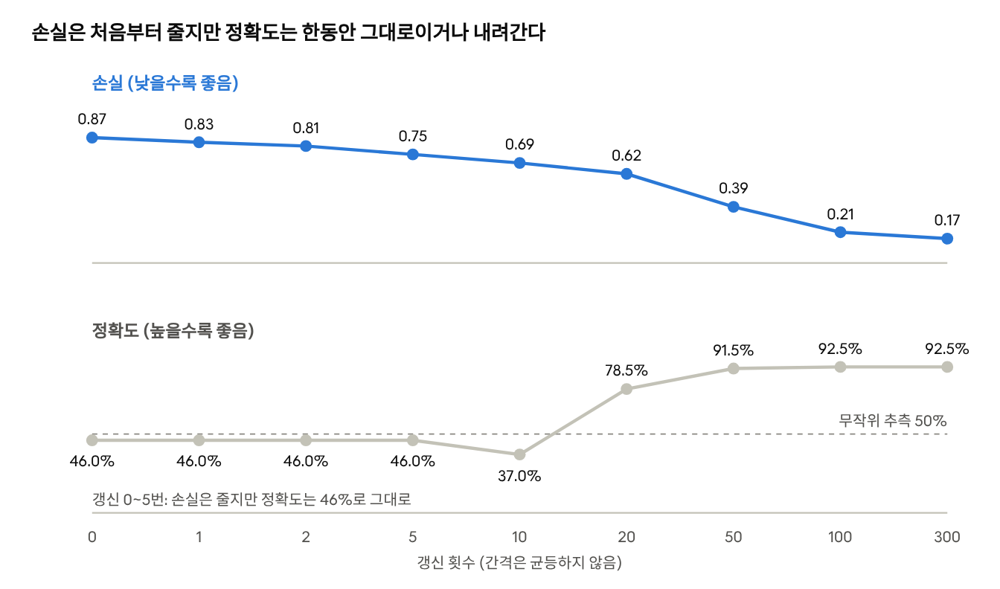
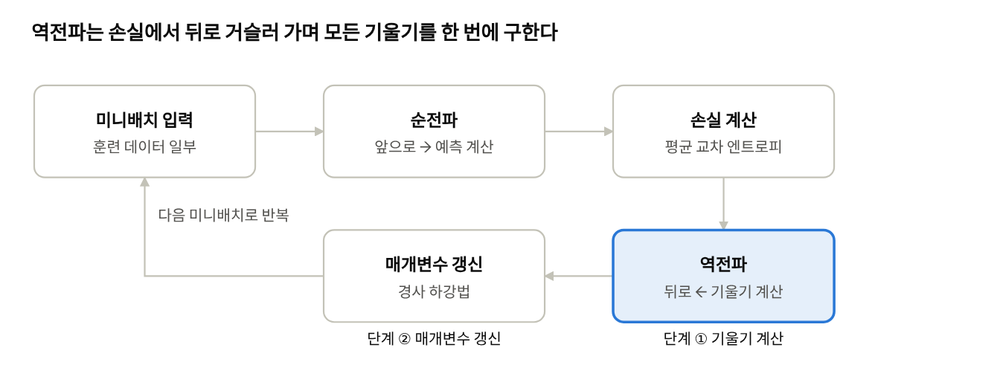

# Day 3 · 이론 4. 신경망 학습과 기울기 계산

Nov 2, 2026 · @Lee Hyunwoo

신경망 학습은 예측과 정답으로 계산한 손실을 줄이는 방향으로 가중치와 편향을 바꾸는 과정이다. 손실을 가중치로 편미분해 기울기를 구하고, 그 반대 방향으로 학습률만큼 이동한다. 기울기 계산은 역전파로 효율적으로 한다.

이 문서는 이론 4의 강의 메모를 정리하고 NumPy와 PyTorch 2.14.1로 직접 실행해 확인한 것이다. 교안 전문은 받지 못했다. 예시의 함수, 신경망, 데이터는 설명을 위해 정한 값이고 교안의 값이 아니다.

## 손실 함수

학습 과정의 목표는 훈련 데이터로 계산한 손실을 줄이는 것이고, 궁극적인 목표는 학습하지 않은 데이터에서도 잘 예측하는 것이다. Day 2의 일반화와 과대적합과 같은 이야기다. 손실 함수는 예측이 정답과 얼마나 다른지 하나의 숫자로 나타낸다. 같은 손실 함수와 같은 평가 데이터라는 조건에서, 손실이 작을수록 그 기준에 더 잘 맞는 예측이다.

### 교차 엔트로피

정답을 원-핫으로 표현하면 정답 클래스 항만 남아 식이 단순해진다. 정답 클래스에 부여한 확률이 낮아지면 손실은 커진다.

```latex
E = -\sum_k t_k \log y_k = -\log y_c
```

예측 (0.7, 0.2, 0.1), 정답 (1, 0, 0)이면 두 식 모두 0.3567이다.

| 정답에 부여한 확률 | 0.99 | 0.9 | 0.6 | 0.5 | 0.1 | 0.01 |
| --- | --- | --- | --- | --- | --- | --- |
| 손실 -log y_c | 0.0101 | 0.1054 | 0.5108 | 0.6931 | 2.3026 | 4.6052 |

### 미니배치 평균 손실

미니배치는 한 번의 매개변수 갱신에 사용하는 데이터 묶음이고, 신경망은 각 샘플의 손실을 평균한 값으로 학습한다. 정답 확률이 0.9, 0.6, 0.1, 0.8인 샘플 4개의 손실은 0.1054, 0.5108, 2.3026, 0.2231이고 평균은 0.7855다. PyTorch `cross_entropy`의 기본 계산도 같은 값이었다.

| 데이터 수 | 배치 크기 | 에포크당 갱신 횟수 |
| --- | --- | --- |
| 12 | 12 | 1 |
| 12 | 4 | 3 |
| 12 | 5 | 3 (마지막 배치는 2개) |
| 12 | 1 | 12 |
| 60,000 | 100 | 600 |

## 왜 정확도 대신 손실로 학습하는가

정확도는 맞혔는지만 평가하므로, 파라미터를 조금 바꿔도 가장 높은 확률의 클래스가 그대로면 값이 변하지 않는다. 학습에는 맞혔는지뿐 아니라 매개변수의 작은 변화가 예측을 어떻게 개선했는지도 알아야 한다.



*샘플 200개 이진 분류, 입력 2 → 은닉 4 → 출력 2, 학습률 0.1 · PyTorch 2.14.1 실행*

손실은 처음부터 줄어 갱신 방향을 알려 주지만, 정확도는 갱신 5번까지 46%에 머물렀고 10번에서는 손실이 줄었는데도 37%로 내려갔다. 손실과 정확도가 항상 같이 움직이지는 않는다.

가중치 하나만 바꾸는 간단한 이진 분류에서도 확인했다. w가 0.5에서 3.0 사이일 때 정확도는 0.667로 항상 같았고 손실은 0.5378에서 0.4623까지 변했다. w = 1에서 수치 기울기는 정확도가 0, 손실이 -0.0654였다. 기울기가 0이면 갱신량도 0이다.

또 손실이 작다고 정확도가 항상 높은 것도 아니다. 정답에 0.51을 준 모델 A는 정확도 100%에 손실 0.6733이고, 네 개 중 하나를 틀린 모델 B(0.99, 0.99, 0.99, 0.45)는 정확도 75%에 손실 0.2072였다. 그래서 **학습은 손실로, 최종 평가는 목적에 맞는 지표로 따로 본다.**

## 미분, 편미분, 기울기, 수치 미분

기울기는 모든 변수의 편미분을 모은 벡터이고, 수치 미분은 그 편미분을 계산하는 한 가지 방법이다.

| 용어 | 뜻 |
| --- | --- |
| 미분 | 한 시점에서 입력이 변할 때 함수값이 변하는 비율 |
| 편미분 | 다른 변수는 고정하고 특정 변수에 대해 구한 미분 |
| 기울기 | 각 변수에 대한 편미분값을 모은 것, 함수값이 가장 빠르게 증가하는 방향 |
| 수치 미분 | 입력을 조금 바꿔 계산한 함수값의 차이로 미분값을 근사하는 방법 |

```latex
\frac{\partial f}{\partial x} \approx \frac{f(x+h)-f(x-h)}{2h}
```

예를 들어 f(x, y) = x² + y²의 점 (3, 4)에서 기울기는 (6, 8)이다. 1° 간격으로 360개 방향을 시험하면 함수값이 가장 빠르게 증가하는 방향은 (0.602, 0.799)로 기울기의 단위 벡터 (0.6, 0.8)와 거의 같았다. 반대 방향이 가장 빠르게 감소하는 방향이다.

앞서 본 Day 2의 경사 이용은 가중치와 절편을 수정한다는 수준이었다. 이번에는 그 경사의 정체가 **각 변수에 대한 손실의 편미분**이라는 데까지 확장된다.

## 경사 하강법

경사 하강법은 현재 값에서 학습률과 기울기를 곱한 값을 빼서 손실이 가장 빠르게 줄어드는 방향으로 이동한다. 기울기는 이동 방향을 정하고, 학습률은 이동폭을 조절한다.

```latex
x_{\text{new}} = x - \eta\,\nabla f(x)
```

위치 (3, 4), 기울기 (6, 8), 학습률 0.1이면 다음과 같이 갱신된다.

| 변수 | 현재 값 | 학습률 × 기울기 | 새 값 |
| --- | --- | --- | --- |
| x₀ | 3 | 0.1 × 6 = 0.6 | 2.4 |
| x₁ | 4 | 0.1 × 8 = 0.8 | 3.2 |

함수 x² + y²에서 함수값은 25에서 16으로 줄어든다. 갱신을 거듭하면 기울기 크기가 10.0, 8.0, 6.4로 작아져, 학습률이 같아도 실제 이동 거리는 1.00, 0.80, 0.64로 저절로 줄어든다.

### 학습률

너무 작으면 학습이 느리고, 너무 크면 최소점을 지나쳐 불안정해진다. 시작점 (3, 4)에서 20번 갱신한 결과다.

| 학습률 | 20번 후 함수값 | 모습 |
| --- | --- | --- |
| 0.01 | 11.14 | 너무 느림 |
| 0.1 | 0.0033 | 잘 수렴 |
| 0.5 | 0 | 이 함수에서만 한 번에 도착 |
| 1.0 | 25 | 제자리에서 튕김 |
| 1.1 | 36,744 | 발산 |

이 경계값은 이 함수의 값이고, 데이터와 모델이 바뀌면 적당한 학습률도 달라진다.

가장 빠르게 줄어드는 방향이 곧 최소점을 향하는 방향은 아니다. 길쭉한 함수 x² + 10y²의 점 (3, 1)에서 -기울기와 최소점을 향한 방향은 54.9° 어긋났다. 그래서 경사 하강법은 매 단계 방향을 다시 계산한다.

### 기울기가 0이면 최소일까

아니다. 기울기가 0이라는 것은 1차 변화율이 0이라는 뜻이고, 최소값과 최대값, 안장점에서 모두 일어난다. 안장점은 한 방향으로는 증가하고 다른 방향으로는 감소하는 지점이다.

| 함수 | (0, 0)에서 기울기 | 2차 미분의 고유값 | 성격 |
| --- | --- | --- | --- |
| x² + y² | (0, 0) | 2, 2 | 최소 |
| -x² - y² | (0, 0) | -2, -2 | 최대 |
| x² - y² | (0, 0) | -2, 2 | 안장점 |

최대점과 안장점은 불안정해서, 시작점이 조금만 어긋나도 경사 하강법이 스스로 벗어난다. 1차원에서도 x³는 x = 0에서 기울기가 0이지만 최소도 최대도 아닌 변곡점이다.

## 신경망에 적용

신경망에서는 변수 x₀, x₁ 자리에 가중치와 편향이, 함수 f 자리에 손실이 들어간다. 각 가중치에는 자신의 기울기가 하나씩 대응하고, 기울기의 모양은 가중치 행렬의 모양과 같다.

```latex
W_{ij} \leftarrow W_{ij} - \eta\,\frac{\partial E}{\partial W_{ij}}
```

입력 2개와 뉴런 3개인 층의 가중치는 2 × 3 = 6개이고, 입력 (1, 2)와 정답 클래스 0일 때 기울기도 6개다.

| 뉴런 | 입력 x₀로 들어오는 가중치 | 입력 x₁로 들어오는 가중치 |
| --- | --- | --- |
| 1 | 0.0327 | 0.0654 |
| 2 | -0.0385 | -0.0770 |
| 3 | -0.0084 | -0.0167 |

수치 미분과 비교한 최대 차이는 1.6 × 10⁻⁵였다. 가중치 하나만 0.01 올렸을 때 손실의 변화는 +0.000327로, 기울기 × 변화량(0.0327 × 0.01)과 같았다. 작은 변화에서는 손실의 변화가 기울기 × 가중치의 변화와 거의 같다.

두 번째 열의 기울기가 첫 번째 열의 정확히 2배인 것은 입력이 x₀ = 1, x₁ = 2이기 때문이다. 샘플 하나일 때의 모습이고, 미니배치에서는 샘플별 기울기를 평균하므로 이렇게 깔끔한 비례가 아니다.

### 기울기 계산과 매개변수 갱신은 다른 단계다

| 단계 | 하는 일 | 방법 | 출력 |
| --- | --- | --- | --- |
| ① 기울기 계산 | 가중치를 바꿨을 때 손실이 얼마나 변하는지 구함 | 수치 미분, 역전파 | 기울기 |
| ② 매개변수 갱신 | 구한 기울기로 가중치를 실제로 수정함 | 경사 하강법 | 새 가중치 |

같은 기울기를 수치 미분(0.05475)과 역전파(0.05474)로 구해도 값이 같았다. 반대로 같은 기울기에 학습률만 바꾸면 한 번 갱신한 뒤 손실이 달라졌다(기준 0.8699: 학습률 0.01에서 0.8574, 0.1에서 0.7498, 1.0에서 0.1570). 학습률 10 이상에서 손실이 0이 되는 것은 샘플이 하나뿐이어서이고, 학습률이 클수록 좋다는 뜻은 아니다.

PyTorch에서 `backward()`는 기울기를 덮어쓰지 않고 누적한다. 같은 샘플로 3번 연속 호출하자 모든 기울기가 1번 계산했을 때의 정확히 3배였다. 그래서 학습 루프는 `zero_grad()`, `backward()`, `step()`을 순서대로 호출한다.

## 역전파

수치 미분은 파라미터마다 순전파를 두 번씩 해야 해서 계산량이 파라미터 수에 비례한다. 실제 신경망은 역전파로 기울기를 효율적으로 구한다. 역전파가 빠른 것은 뒤쪽에서 구한 값을 앞 층이 재사용해 중복 계산이 없어지기 때문이다.



*학습 한 바퀴의 흐름 · 강의 메모 정리*

입력 784 → 은닉 w → 은닉 w → 출력 10인 신경망을 배치 64로 측정한 결과다.

| 은닉 너비 | 파라미터 | 순전파 | 순전파+역전파 | 비율 | 수치 미분(어림) |
| --- | --- | --- | --- | --- | --- |
| 64 | 55,050 | 0.07ms | 0.28ms | 4.0배 | 약 8초 |
| 256 | 269,322 | 0.16ms | 0.43ms | 2.6배 | 약 89초 |
| 1024 | 1,863,690 | 0.65ms | 1.90ms | 2.9배 | 약 2,421초 |
| 2048 | 5,824,522 | 1.59ms | 4.89ms | 3.1배 | 약 18,491초 |

역전파는 파라미터가 100배 넘게 늘어도 순전파의 약 3배로 비슷하다. 수치 미분 시간은 순전파 한 번의 시간에 2 × 파라미터 수를 곱한 어림값이고, 모든 시간은 실행 환경에 따라 달라진다. 파라미터가 100억 개이면 수치 미분은 순전파 약 200억 번이 필요하고, 역전파는 약 3번분이다.

### 뒤에서 앞으로 가는 이유

2-3-2 신경망(시그모이드, 교차 엔트로피)에서 손으로 쓴 역전파는 PyTorch 자동 미분과 최대 4.4 × 10⁻⁸ 이하로 같았다.

| 단계 | 계산 | 하는 일 |
| --- | --- | --- |
| 출력 쪽 시작 | ∂E/∂a₂ = p - t = (-0.4045, 0.4045) | 예측 확률에서 정답을 뺀 값 |
| 둘째 층 기울기 | 이 값 × 은닉 출력 | 둘째 층 가중치의 기울기 |
| 한 층 뒤로 전달 | 이 값 × 둘째 층 가중치 × 시그모이드 기울기 | 첫 층의 시작값 |
| 첫 층 기울기 | 이 값 × 입력 | 첫 층 가중치의 기울기 |

뒤쪽에서 구한 값을 앞 층이 그대로 받아 쓴다. 수치 미분은 가중치마다 처음부터 순전파를 다시 하지만, 역전파는 뒤에서 앞으로 한 번 훑으며 중복 계산을 없앤다.

역전파가 수치 미분보다 빠르다는 것이지 순전파보다 싼 것은 아니다. 학습은 배치마다 둘 다 하므로 추론보다 약 3배의 계산이 든다. 중간 결과를 저장해 두어야 해서 메모리도 더 쓰는데, 이 실험에서 메모리 사용량은 측정하지 않았다.

## 헷갈리기 쉬운 내용과 핵심 질문

가장 자주 헷갈리는 것은 기울기 계산과 매개변수 갱신의 구분이다. 수치 미분과 역전파는 ①의 방법이고, 경사 하강법은 ②의 방법이다.

| 헷갈리기 쉬운 이해 | 정확한 내용 |
| --- | --- |
| 정확도로 학습하지 않으니 정확도는 안 본다 | 학습은 손실로, 최종 평가는 목적 지표로 따로 본다 |
| 손실이 작을수록 항상 정확도가 높다 | 같은 손실 함수와 같은 평가 데이터에서만 그 기준에 더 잘 맞는다는 뜻이다 |
| 기울기가 0이면 최소다 | 최소, 최대, 안장점 모두 기울기가 0이다 |
| 가장 빠르게 줄어드는 방향이 최소점을 향한다 | 길쭉한 함수에서는 방향이 어긋난다 |
| 학습률은 이동폭만 정한다 | 실제 이동 거리는 학습률 × 기울기 크기다 |
| 수치 미분과 경사 하강법은 같은 층위다 | 기울기 계산 방법과, 그 기울기로 갱신하는 방법이다 |
| 역전파는 순전파보다 싸다 | 수치 미분보다 빠를 뿐, 학습은 추론의 약 3배 계산이 든다 |

### 핵심 질문 답안

1. **신경망 학습에서 무엇을 무엇으로 바꾸는가?** 가중치와 편향을, 예측과 정답으로 계산한 손실이 줄어드는 방향으로 바꾼다.
2. **왜 정확도 대신 손실로 학습하는가?** 정확도는 작은 변화에 값이 변하지 않아 기울기가 0인 구간이 많다.
3. **미분, 편미분, 기울기는 무엇인가?** 변화율, 다른 변수를 고정한 특정 변수의 변화율, 모든 변수의 편미분을 모은 것이다.
4. **수치 미분과 경사 하강법의 차이는?** 수치 미분은 입력을 조금 바꿔 미분값을 근사하는 기울기 계산 방법이고, 경사 하강법은 그 기울기로 매개변수를 갱신하는 방법이다.
5. **갱신식은 어떻게 쓰는가?** 현재 매개변수에서 학습률과 기울기를 곱한 값을 뺀다.
6. **왜 역전파가 필요한가?** 수치 미분은 파라미터 수에 비례해 계산량이 늘고, 역전파는 순전파의 약 3배로 일정하다.

메모가 끊겨 있던 마지막 부분은 확인하지 못했고, 이후 내용은 교안이 나오면 이어서 정리한다.
