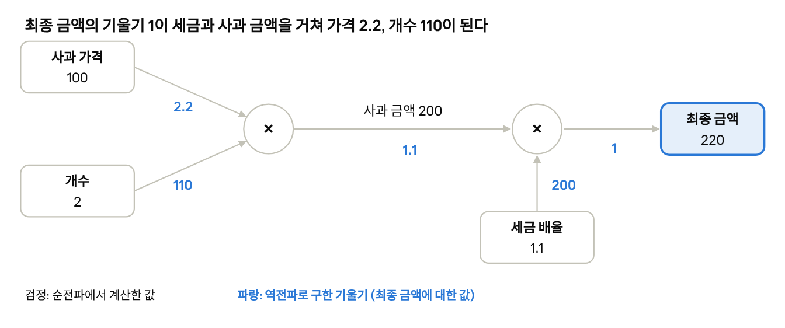
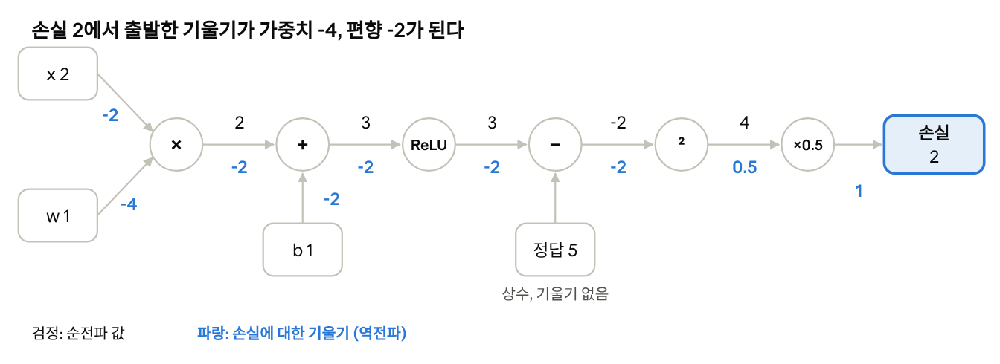

# Day 3 · 이론 5. 계산 그래프와 오차역전파법

Nov 2, 2026 · @Lee Hyunwoo

역전파는 손실에서 시작해 계산 그래프를 거꾸로 지나며, 각 노드에서 "전달받은 기울기 × 그 연산의 국소적 미분"을 반복해 모든 가중치와 편향의 기울기를 한 번에 구하는 방법이다. 이 규칙은 덧셈, 곱셈, ReLU, 시그모이드에서 모두 같고, 달라지는 것은 국소적 미분뿐이다.

이 문서는 이론 5의 교안과 강의 메모를 정리하고, 교안의 모든 숫자를 수치 미분과 PyTorch 2.14.1로 직접 실행해 확인한 것이다. 확인 결과 교안 8.6절 본문의 편향 기울기 부호 하나만 틀렸다(2가 아니라 -2). 예시의 함수와 값은 교안의 것을 그대로 썼다.

## 계산 그래프와 순전파

계산 그래프는 계산을 연산 노드와 값이 흐르는 화살표로 나타낸 것이다. 노드는 자기 입력만 알면 자기 연산을 할 수 있고, 이것이 국소적 계산이다.

사과 한 개 100원, 2개, 소비세 10%를 두 번의 곱셈으로 나눈 예시다.

| 순서 | 들어오는 값 | 연산 | 나가는 값 |
| --- | --- | --- | --- |
| 첫 번째 | 사과 가격 100, 개수 2 | 곱하기 | 사과 금액 200 |
| 두 번째 | 사과 금액 200, 세금 배율 1.1 | 곱하기 | 최종 금액 220 |

세금 배율 1.1은 원래 금액의 100%에 세금 10%를 더한 배율이다. 두 번째 노드는 200이 어떻게 만들어졌는지 몰라도 200 × 1.1만 계산하면 된다. 입력에서 출발해 연산 순서대로 값을 구하는 과정이 순전파다.

파이썬에서 200 × 1.1은 부동소수점 때문에 220.00000000000003으로 나온다. 최종 금액을 `==`로 비교하지 말고 `round()`나 `np.isclose()`를 쓴다.

## 국소적 미분

국소적 미분은 한 연산에서 입력이 조금 바뀔 때 그 연산의 출력이 바뀌는 비율이다. 최종 결과가 아니라 노드 하나의 출력에 대한 변화율이고, 최종 결과에 미치는 영향은 뒤에서 전달받은 기울기에 이 값을 곱해서 구한다.

### 덧셈 노드

10 + 5 = 15에서 첫 번째 입력을 11로 올려도, 두 번째 입력을 6으로 올려도 출력은 16이다. 국소적 미분은 두 입력 모두 1이다.

```latex
z = x + y:\qquad \frac{\partial z}{\partial x} = 1,\quad \frac{\partial z}{\partial y} = 1
```

**덧셈 노드는 전달받은 기울기를 각 입력에 그대로 전달한다.** 입력이 두 개라고 절반씩 나누지 않는다. 각 입력이 최종 결과에 미치는 영향을 따로 구하기 때문이다.

### 곱셈 노드

10 × 5 = 50에서 첫 번째 입력을 11로 올리면 55(+5), 두 번째 입력을 6으로 올리면 60(+10)이다. 한 입력의 변화는 다른 쪽 입력값만큼 출력을 바꾼다.

```latex
z = xy:\qquad \frac{\partial z}{\partial x} = y,\quad \frac{\partial z}{\partial y} = x
```

**곱셈 노드는 전달받은 기울기에 다른 쪽 입력값을 곱해 전달한다.** 자기 값이 아니라 상대의 값이다.

| 뒤에서 전달받은 기울기 1.3 | 값이 10인 입력 | 값이 5인 입력 |
| --- | --- | --- |
| 덧셈 노드 | 1.3 × 1 = 1.3 | 1.3 × 1 = 1.3 |
| 곱셈 노드 | 1.3 × 5 = 6.5 | 1.3 × 10 = 13 |

노드 뒤에 1.3을 곱하는 계산을 붙여 입력을 0.01 올려 보면, 최종 결과 변화는 덧셈 +0.013, 곱셈 +0.065와 +0.13으로 모두 기울기 × 0.01과 같았다.

### 순전파 값을 저장해야 하는 이유

곱셈의 역전파에는 순전파 입력값이 다시 필요하다. 10과 5를 곱했다면 역전파에서 5와 10을 쓴다. 덧셈은 저장할 값이 없다. 곱셈 노드에서 (10, 5)로 순전파한 뒤 역전파 전에 (3, 7)로 한 번 더 순전파하면 저장값이 덮어써져 역전파가 (9.1, 3.9)로 틀리게 나온다. 올바른 값은 (6.5, 13)이다.

국소적 미분은 작은 변화에서만 정확하다. 곱셈에서 두 입력을 동시에 1씩 올리면 실제 출력 변화는 16이고 국소적 미분으로 예측한 값은 15다. 변화를 0.01로 줄이면 0.1501 대 0.1500으로 거의 같아진다.

## 연쇄법칙

연쇄법칙은 각 단계의 변화율을 곱하면 처음 입력이 최종 결과에 미치는 변화율을 구할 수 있다는 규칙이다. 입력 2와 3을 더한 뒤 제곱하는 계산을 덧셈 노드와 제곱 노드로 나눈다. 입력을 x, y, 중간값을 s, 최종 결과를 z라고 하면 s = x + y, z = s²이다.

| 방향 | 단계 | 값 |
| --- | --- | --- |
| 순전파 | 덧셈 노드: 2 + 3 | s = 5 |
| 순전파 | 제곱 노드: 5² | z = 25 |
| 역전파 | 시작 기울기 | 1 |
| 역전파 | 제곱 노드: 1 × (2 × 5) | 10 |
| 역전파 | 덧셈 노드: 10 × 1 | x로 10, y로 10 |
| 수치 미분 | ∂z/∂x, ∂z/∂y | 10.0, 10.0 |

```latex
\frac{\partial z}{\partial x} = \frac{\partial z}{\partial s} \times \frac{\partial s}{\partial x} = 10 \times 1 = 10
```

**시작 기울기 1은 최종 결과가 1이라는 뜻이 아니다.** 최종 결과를 자기 자신으로 미분한 값이 1이라는 뜻이고, 순전파 결과는 여전히 25다. 함수를 z = 3(x + y)²로 바꾸면 z는 75가 되지만 시작 기울기는 그대로 1이고, 역전파 결과는 30으로 수치 미분(30.0)과 같았다.

제곱 노드는 순전파 입력 5를 저장해야 한다. 출력 25를 쓰면 2 × 25 = 50으로 틀린다.

### 기울기는 점마다 다르다

| 입력 (x, y) | z | 기울기 |
| --- | --- | --- |
| (2, 3) | 25 | (10, 10) |
| (0, 1) | 1 | (2, 2) |
| (-3, 1) | 4 | (-4, -4) |
| (-1, 1) | 0 | (0, 0) |
| (5, 5) | 100 | (20, 20) |

기울기 10은 "첫 입력을 0.01 올리면 최종 결과가 약 0.1 늘어난다"는 예측이고 실제 변화는 0.1001이었다. 증가량이 0.1이면 1.0100(예측 1.0000), 0.5이면 5.25(예측 5), 1이면 11(예측 10)로 변화가 커질수록 어긋난다.

## 사과 구매 그래프의 전체 역전파

순전파에서 화살표에 적는 숫자는 계산된 값이고, 역전파에서 적는 숫자는 그 값에 대한 최종 결과의 기울기다. 시작은 최종 금액의 기울기 1이다.



*사과 구매 그래프 · 교안 5장 · 기울기는 입력을 실제로 바꿔 확인*

세금 곱셈 노드에서는 사과 금액 쪽이 1 × 1.1 = 1.1, 세금 배율 쪽이 1 × 200 = 200이다. **자기 값이 아니라 상대 입력값을 곱한다.** 사과 금액 곱셈 노드에서는 처음의 1이 아니라 방금 전달받은 1.1을 써서, 가격 쪽이 1.1 × 2 = 2.2, 개수 쪽이 1.1 × 100 = 110이다.

입력을 실제로 바꿔도 같은 값이 나왔다. 기준 최종 금액은 220이다.

| 바꾼 입력 | 실제 최종 금액 변화 | 연쇄법칙 계산 |
| --- | --- | --- |
| 사과 가격 +1 | +2.2 | 2 × 1.1 = 2.2 |
| 사과 개수 +1 | +110 | 100 × 1.1 = 110 |
| 세금 배율 +0.01 | +2.0 | 200 × 0.01 = 2.0 |
| 사과 금액 200 → 201 | +1.1 | 1.1 |

사과 가격의 기울기 2.2는 사과 한 개 가격이 1원 오르면 최종 금액이 2.2원 늘어난다는 뜻이다. 사과가 2개라 사과 금액이 2원 늘고, 세금 배율 1.1이 곱해져 2.2원이 된다. 이 그래프는 각 입력에 대해 선형이라 큰 변화에서도 정확하다.

### 사과·귤 그래프

사과(100원, 2개)와 귤(150원, 3개)을 함께 사면 합계 650, 세금 포함 715다. 세금 노드에서 세전 합계 쪽이 1.1, 세금 배율 쪽이 650이고, 덧셈 노드는 1.1을 절반으로 나누지 않고 두 금액에 그대로 전달한다.

| 입력 | 기울기 | 계산 |
| --- | --- | --- |
| 사과 가격 | 2.2 | 1.1 × 2 |
| 사과 개수 | 110 | 1.1 × 100 |
| 귤 가격 | 3.3 | 1.1 × 3 |
| 귤 개수 | 165 | 1.1 × 150 |
| 세금 배율 | 650 | 1 × 650 |

그래프가 커져도 각 노드에서 확인할 것은 네 가지다. 지금 어떤 연산을 지나는가, 출력 쪽에서 어떤 기울기가 왔는가, 어느 입력 쪽에 무엇을 곱해야 하는가, 계산 결과를 어느 화살표에 적는가. 이를 반복하면 전체 함수를 한 번에 미분하지 않아도 모든 입력의 기울기를 구할 수 있다.

## 같은 규칙을 신경망에 적용

신경망도 작은 연산을 연결한 그래프다. 입력에 가중치를 곱하고 편향을 더한 뒤 활성화 함수를 거쳐 예측값과 손실을 계산한다. 계산이 복잡해질 뿐 역전파의 기본 원리는 같다. **전달받은 기울기에 현재 연산의 국소적 미분을 곱한다.**

### Affine 계층

Affine 계층 z = xw + b는 곱셈 노드와 덧셈 노드로 펼쳐진다. 뒤에서 -2가 전달되고 입력 2, 가중치 1일 때다.

| 노드 | 방향 | 계산 | 값 |
| --- | --- | --- | --- |
| 덧셈 | 편향 쪽 | 그대로 전달 | -2 |
| 덧셈 | 곱셈 결과 쪽 | 그대로 전달 | -2 |
| 곱셈 | 가중치 쪽 | -2 × 입력 2 | -4 |
| 곱셈 | 입력 쪽 | -2 × 가중치 1 | -2 |

PyTorch 자동 미분도 입력 -2, 가중치 -4, 편향 -2로 같았다. 여러 샘플을 행렬로 처리하면 같은 모양이 된다.

| 기울기 | 식 | 크기 (샘플 4, 입력 3, 뉴런 2) |
| --- | --- | --- |
| 입력 X | dY @ Wᵀ | (4, 3) |
| 가중치 W | Xᵀ @ dY | (3, 2) |
| 편향 b | dY를 샘플 방향으로 합 | (2,) |

편향의 기울기는 샘플별 기울기를 더한 값이다. 편향이 모든 샘플에 같은 값으로 더해지기 때문이다.

### ReLU

ReLU는 순전파 입력이 양수이면 기울기를 통과시키고 음수이면 0으로 막는다. 기준은 기울기의 부호가 아니라 **순전파 입력의 부호**다. 뒤에서 기울기 2가 전달될 때 결과다.

| 순전파 입력 | 국소적 미분 | 전달할 기울기 |
| --- | --- | --- |
| 3 | 1 | 2 |
| -3 | 0 | 0 |
| 0.5 | 1 | 2 |
| -0.1 | 0 | 0 |

입력이 정확히 0일 때 PyTorch는 기울기를 0으로 처리한다. 순전파 입력의 부호(마스크)를 저장해 두었다가 역전파에서 쓴다.

### 시그모이드

시그모이드의 국소적 미분은 출력 y에서 y(1 - y)다. 가운데에서는 기울기가 최대 0.25로 잘 통과하고 양 끝에서는 거의 막힌다. 뒤에서 기울기 2가 전달될 때 결과다.

| 순전파 입력 | 출력 y | 국소적 미분 | 전달할 기울기 |
| --- | --- | --- | --- |
| -6 | 0.0025 | 0.0025 | 0.0049 |
| -2 | 0.1192 | 0.1050 | 0.2100 |
| 0 | 0.5 | 0.25 | 0.5 |
| 2 | 0.8808 | 0.1050 | 0.2100 |
| 6 | 0.9975 | 0.0025 | 0.0049 |

ReLU는 입력의 부호를, 시그모이드는 순전파 출력 y를 저장해야 한다. 이론 3에서 본 기울기 소실의 원리가 이 표다.

### 손실 계층에서 시작

역전파는 손실에서 시작한다. 분류 신경망에서 소프트맥스와 교차 엔트로피를 결합하면 출력 점수의 기울기는 예측 확률에서 정답을 뺀 값이다.

```latex
\frac{\partial E}{\partial a} = y - t
```

점수 (2, 1, -1), 정답 클래스 0이면 y = (0.7054, 0.2595, 0.0351)이고 기울기는 (-0.2946, 0.2595, 0.0351)로 PyTorch와 일치했다. 배치 평균 손실이면 샘플 수 N으로 나눈 (y - t) / N이다.

이 식은 짝에 따라 성립한다. 시그모이드와 이진 교차 엔트로피 짝에서도 y - t가 나오지만 시그모이드를 MSE와 묶으면 달라진다. 시그모이드가 확신을 가지고 틀린 경우(점수 -6, 정답 1)에 이진 교차 엔트로피 기울기는 -0.9975로 크게 고치는 반면, MSE 기울기는 -0.0025로 거의 고치지 못한다. 분류에서 교차 엔트로피를 쓰는 이유 중 하나다.

## 작은 신경망 한 번의 학습

하나의 입력에 가중치를 곱하고 편향을 더한 뒤 ReLU를 적용해 숫자 하나를 예측하는 예제다. 손실은 (예측값 − 정답)²의 절반이다. 입력 2, 가중치 1, 편향 1, 정답 5, 학습률 0.1이다.



*입력 2, 가중치 1, 편향 1, 정답 5 · 교안 8장 · 가중치·편향의 기울기를 수치 미분으로 확인*

순전파는 곱셈 2, 덧셈 3, ReLU 3(예측값), 정답 빼기 -2, 제곱 4, 절반 곱하기 2(손실)이다. 역전파는 시작 기울기 1에서 출발한다.

| 노드 | 계산 | 전달할 기울기 |
| --- | --- | --- |
| 절반 곱하기 | 1 × 0.5 | 0.5 |
| 제곱 | 0.5 × (2 × (-2)) | -2 |
| 정답 빼기 | -2 × 1 | -2 |
| ReLU (순전파 입력 3, 양수) | -2 × 1 | -2 |
| 덧셈 | 그대로 전달 | 편향 -2, 곱셈 결과 -2 |
| 곱셈 | 가중치 쪽 -2 × 입력 2, 입력 쪽 -2 × 가중치 1 | 가중치 -4, 입력 -2 |

제곱 노드는 출력 4가 아니라 순전파 입력 -2를 쓴다. 가중치와 편향의 기울기 -4, -2는 수치 미분으로도 -4.0, -2.0이었다. 정답은 상수라서 기울기를 받지 않는다. 예측값 − 정답과 정답 − 예측값 중 어느 순서로 빼도 예측값에 도착하는 기울기는 -2로 같고 중간 노드의 부호만 달라진다.

### 한 번 갱신하고 다시 순전파

| 매개변수 | 현재 값 | 기울기 | 갱신 계산 | 새 값 |
| --- | --- | --- | --- | --- |
| 가중치 | 1 | -4 | 1 − 0.1 × (-4) | 1.4 |
| 편향 | 1 | -2 | 1 − 0.1 × (-2) | 1.2 |

새 가중합은 2 × 1.4 + 1.2 = 4로 예측값 4, 손실은 2에서 0.5로 줄었다. 음수 기울기를 빼므로 두 값 모두 늘어난다.

### 학습률과 죽은 ReLU

같은 예제를 학습률만 바꿔 10번 갱신했다.

| 학습률 | 손실의 변화 | 결과 |
| --- | --- | --- |
| 0.05 | 2 → 1.125 → 0.633 → … | 천천히 감소 |
| 0.1 | 2 → 0.5 → 0.125 → … | 빠르게 감소 |
| 0.2 | 2 → 0 | 한 번에 도달 |
| 0.4 | 2 → 2 → 2 → … | 제자리에서 진동 |
| 0.45 | 2 → 3.13 → 4.88 → … | 손실 증가 |
| 0.5 | 2 → 4.5 → 10.1 → … | 손실 증가 |

학습률이 0.45 이상이면 손실이 늘다가 12.5에서 멈춘다. 가중합이 음수로 넘어가 ReLU의 출력이 0이 되고, 손실 (0 − 5)²/2 = 12.5에서 기울기가 0이 되기 때문이다. 가중치를 -2로 두고 수치 미분을 해도 두 기울기가 모두 0.0이었다. 이 경계값은 이 예제의 값이다.

## 헷갈리기 쉬운 내용과 핵심 질문

가장 자주 헷갈리는 것은 곱셈 노드에서 어느 값을 곱하는지다. 자기 입력값이 아니라 다른 쪽 입력값을 곱한다.

| 헷갈리기 쉬운 이해 | 정확한 내용 |
| --- | --- |
| 국소적 미분은 입력이 최종 결과에 미치는 영향이다 | 그 노드 하나의 출력에 대한 변화율이고, 최종 영향은 전달받은 기울기와 곱해서 구한다 |
| 시작 기울기 1은 최종 결과가 1이라는 뜻이다 | 최종 결과를 자기 자신으로 미분한 값이고 순전파 결과(25 등)는 그대로다 |
| 덧셈 노드는 기울기를 입력 수만큼 나눈다 | 각 입력에 그대로 전달한다 |
| 곱셈 노드도 기울기를 그대로 전달한다 | 다른 쪽 입력값을 곱한다 |
| 제곱 노드는 출력으로 미분한다 | 순전파 입력(5)을 쓴다 |
| ReLU는 기울기가 음수이면 막는다 | 순전파 입력이 음수일 때 막는다 |
| 역전파는 선형 연산만 다룬다 | 활성화 함수도 각자의 국소적 미분으로 지난다 |
| 역전파가 빠른 것은 연쇄법칙을 써서다 | 뒤쪽에서 구한 값을 앞 층이 재사용해 중복 계산이 없어지기 때문이다 |
| 기울기를 구하면 학습이 끝났다 | 기울기를 구한 뒤 갱신해야 가중치가 바뀐다 |
| 같은 변수의 여러 경로 기울기는 하나만 쓴다 | 더한다 (x * x에서 3 + 3 = 6, x + x에서 1 + 1 = 2) |

### 교안에서 고칠 부분

- **8.6절 본문의 편향 기울기 부호.** "편향 쪽 기울기: 2, 곱셈 결과 쪽 기울기: 2"는 -2가 맞다. 바로 아래 표(편향 -2)와 8.8절의 갱신(1 − 0.1 × (-2) = 1.2)은 -2를 쓰고 있다. 수치 미분으로도 -2.0이었다.
- **그림 13개의 링크가 깨졌다.** `!02_add_multiply_backward.png`처럼 이미지 문법이 깨져 파일명만 남았다(02, 03A~C, 04, 05A~B, 06~08, 09A~C). 그림은 교안 원문에서 확인한다.
- **4.1절의 표기.** "입력을 각각 x,y 중간값을 s"에는 쉼표나 조사가 빠져 있다.
- **7.3절의 ReLU 0 지점.** 0 지점의 기울기를 0으로 처리하는 것은 PyTorch의 동작이고 프레임워크마다 다를 수 있다.

### 핵심 질문 답안

1. **덧셈 다음 제곱, 입력 1과 2, 시작 기울기 1이면?** 제곱 노드의 입력은 3이라 국소적 미분은 2 × 3 = 6이고, 덧셈 결과 쪽 기울기도 6이다. 덧셈은 그대로 전달하므로 두 입력의 기울기는 각각 6이다.
2. **입력 4와 3, 전달받은 기울기 2일 때 곱셈의 잘못된 계산은?** 자기 입력값을 곱했다. 값이 4인 입력 쪽은 2 × 3 = 6, 값이 3인 입력 쪽은 2 × 4 = 8이 맞다.
3. **기울기를 구했다면 학습이 끝났는가?** 아니다. 역전파 직후에는 기울기만 구한 상태이고 가중치는 아직 1이다. 1 − 0.1 × (-4) = 1.4로 갱신해야 바뀐다. 음수 기울기를 빼므로 가중치가 증가하고, 가중치를 늘리면 손실이 감소한다는 뜻이다.
4. **같은 변수가 여러 경로로 쓰이면?** 돌아오는 기울기를 더한다.
5. **계산한 기울기가 맞는지 어떻게 확인하는가?** 수치 미분으로 구한 기울기와 비교한다(기울기 확인). 이 문서의 가중치 -4, 편향 -2도 수치 미분과 같았다.
